# pixel-buddy

Plugin giao diện cho **Claude Code trong app Claude desktop** (và VS Code): thêm một chú Claude pixel động đậy trong lúc làm việc, một dải HUD trên khung nhập, tip xoay vòng và các dòng tool có icon.

Plugin chỉ vẽ giao diện. Nó không gửi dữ liệu ra ngoài, không đọc file của bạn và không đổi cách Claude làm việc.



Lúc rảnh, chú Claude trên HUD ngủ gật và chào bạn theo giờ:



## Có gì

| Phần | Mô tả |
|---|---|
| 🦀 **Claude pixel khi làm việc** | Thay dòng chấm "Đang suy nghĩ…" bằng chú Claude pixel ngồi gõ laptop: tay gõ phím, code cuộn trên màn hình, chớp mắt, nhảy, cà phê bốc khói. Lúc suy nghĩ thì gãi đầu và hiện bong bóng suy nghĩ. |
| 🎛 **HUD trên khung nhập** | Lời chào theo giờ kèm tên bạn, thư mục đang làm, model, đồng hồ, số lượt và số tool đã chạy. Lúc rảnh chú Claude nhỏ ngủ, lúc làm thì tỉnh dậy vẫy tay. |
| 💡 **Tip xoay vòng** | Dòng gợi ý dưới khung nhập đổi tip mỗi 2 phút. Khi Claude đang chạy thì nhắc "Esc để dừng". |
| ⚡ **Dòng tool có icon** | Mỗi tool một dòng gọn: `⚡ Bash  npm test  ✓ 3.2s`, `📖 Read  App.tsx`, `🔍 Grep  "useState"`. Xanh là xong, đỏ là lỗi, vàng là đang chạy. Ctrl+O vẫn xem được bản đầy đủ. |

> Trong terminal, plugin giữ nguyên giao diện mặc định. SVG động chỉ vẽ được trong app desktop và VS Code.

## Yêu cầu

- Claude Code bản có hỗ trợ plugin hooks (cài bản mới nhất).
- Dùng trong app Claude desktop (tab Code) hoặc extension VS Code.

## Cài đặt

### Cách 1: từ terminal (khuyên dùng)

Mở một phiên `claude` trong terminal và gõ:

```text
/plugin install pixel-buddy --marketplace tannghia025/pixel-buddy
```

Hoặc chạy thẳng từ shell:

```bash
claude plugin install pixel-buddy --marketplace tannghia025/pixel-buddy
```

Lần lượt:
1. Gõ `y` khi được hỏi `Add marketplace?`.
2. Chọn phạm vi **user** (Enter) để plugin có ở mọi dự án.
3. Điền tên của bạn và các tuỳ chọn khác ở màn hình cấu hình (xem [Tuỳ chỉnh](#tuỳ-chỉnh)).

Plugin cài ở phạm vi user cũng chạy trong app desktop. Các phiên mở **sau khi cài** sẽ có giao diện mới.

### Cách 2: trong app Claude desktop

1. Bấm **+** cạnh khung nhập → **Plugins**.
2. **Add marketplace** → nhập `tannghia025/pixel-buddy`.
3. **Add plugin** → chọn `pixel-buddy`.

### Cách 3: từ thư mục trên máy (không cần GitHub)

```bash
git clone https://github.com/tannghia025/pixel-buddy.git
```

```bash
claude plugin marketplace add ./pixel-buddy
```

```bash
claude plugin install pixel-buddy@pixel-buddy --scope user
```

### Repo private

Nếu repo để private, người cài phải được mời vào repo trên GitHub, và máy họ phải có sẵn quyền git với github.com (SSH key, hoặc `gh auth login` rồi `gh auth setup-git`). Lệnh cài không tự hỏi mật khẩu.

## Tuỳ chỉnh

| Tuỳ chọn | Mặc định | Ý nghĩa |
|---|---|---|
| `user_name` | `bạn` | Tên trong lời chào, ví dụ "Chào buổi sáng, Nam ☀️" |
| `buddy_name` | `Đệ` | Tên chú Claude tự xưng khi làm việc, ví dụ "Đệ đang cày…" |
| `utc_offset` | `7` | Múi giờ cho đồng hồ và lời chào (7 = Việt Nam, 9 = Nhật, -5 = New York) |
| `show_spinner` | `true` | Bật/tắt chú Claude pixel thay dòng chấm |
| `show_hud` | `true` | Bật/tắt dải HUD trên khung nhập |
| `show_tips` | `true` | Bật/tắt tip xoay vòng |
| `show_tool_rows` | `true` | Bật/tắt dòng tool có icon |

Xem giá trị hiện tại:

```bash
claude plugin configure pixel-buddy
```

Đổi giá trị (các tuỳ chọn không ghi giữ nguyên):

```bash
echo '{"user_name":"Nam","buddy_name":"Bé","utc_offset":"7"}' | claude plugin configure pixel-buddy --values-stdin
```

Trong phiên `claude` ở terminal, bạn cũng đổi được qua menu cấu hình plugin. Đổi xong, mở phiên mới (hoặc khởi động lại phiên) để áp dụng.

## Cập nhật và gỡ

```bash
claude plugin update pixel-buddy
```

```bash
claude plugin uninstall pixel-buddy
```

Tạm tắt mà không gỡ:

```bash
claude plugin disable pixel-buddy
```

## Phát triển

```text
.claude-plugin/
  plugin.json        manifest + các tuỳ chọn (userConfig)
  marketplace.json   biến repo thành marketplace để cài bằng một lệnh
hooks/
  hooks.json         khai báo module hooks
  register.tsx       điểm vào: đọc tuỳ chọn, bật từng phần
  config.ts          đọc và kiểm tra tuỳ chọn
  crab.ts            sprite SVG của chú Claude (animation SMIL, không có script)
  hud.tsx            dải HUD trên khung nhập
  hint.ts            tip xoay vòng
  tools.tsx          dòng tool có icon và bộ đếm thời gian
```

Chạy thử từ thư mục mà không cần cài:

```bash
claude --plugin-dir ./pixel-buddy
```

Kiểm tra trước khi đẩy lên:

```bash
claude plugin validate ./pixel-buddy
```

Màu chỉ dùng các tên màu theo theme của Claude Code (`claude`, `success`, `error`, `warning`, `subtle`), nên giao diện hợp cả theme sáng lẫn tối.

## Giấy phép

[MIT](LICENSE)
